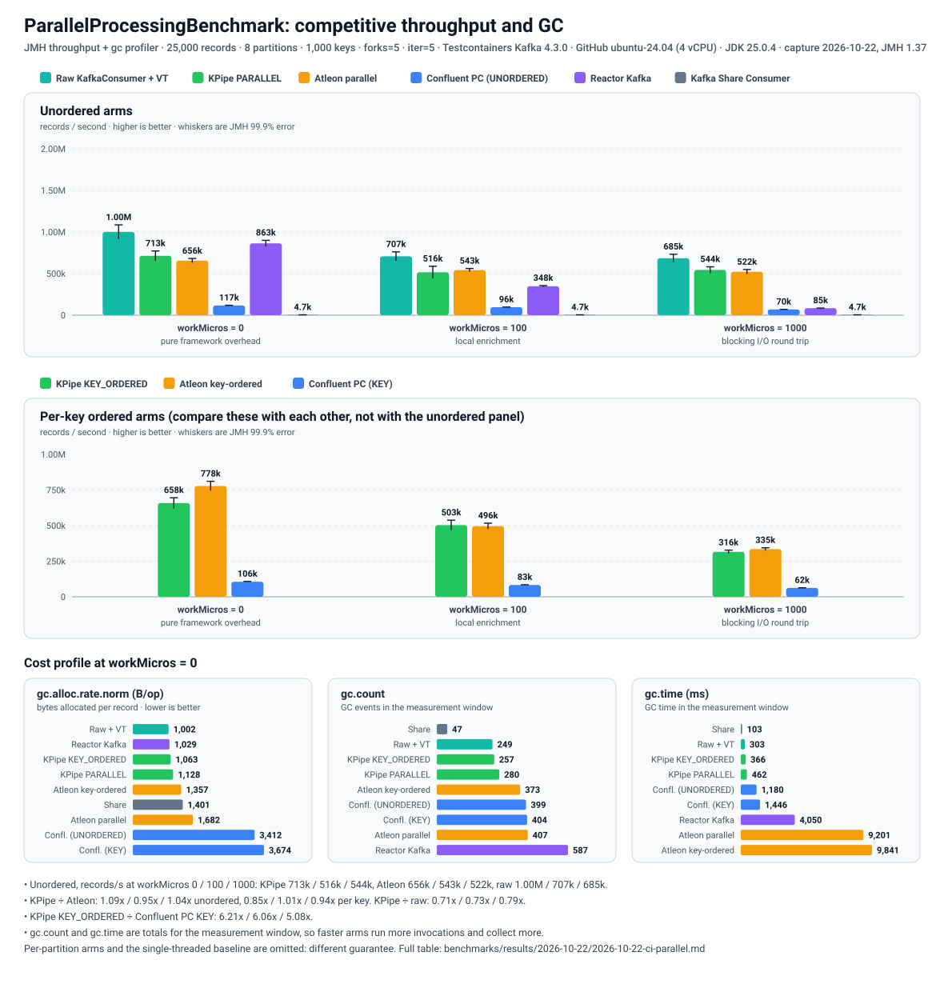

# KPipe Benchmarks

JMH benchmarks (plus one non-JMH latency harness) for KPipe. Two design-validation benches pit KPipe against a
hand-rolled straw man; a competitive suite pits KPipe against the alternatives a JVM team would actually pick (Kafka
Share Consumer, Confluent Parallel Consumer, Reactor Kafka, Atleon, a raw `KafkaConsumer + virtual threads`, and a
single-threaded consumer); and three micro-benches isolate internals.

**The numbers live in [`results/`](results/), one dated snapshot per capture.** Embedding a single run here is how the
old README drifted out of sync. Read [`METHODOLOGY.md`](METHODOLOGY.md) before quoting any figure; it explains what each
bench isolates, why fork count matters, and which comparisons hold up.

## Benchmark scenarios

### Design validation (in-memory, no broker)

These pit KPipe against a straw man to check that the design choices paid off. Don't quote them as competitive numbers.

| Bench                   | `@Benchmark` arms                                                        | What it isolates                                                                                         |
| ----------------------- | ------------------------------------------------------------------------ | -------------------------------------------------------------------------------------------------------- |
| `JsonPipelineBenchmark` | `kpipeJsonPipeline`, `manualJsonSingleSerDe`, `manualJsonSerDeChained`   | KPipe's single-SerDe-cycle vs a naive byte→object→byte chain that re-serializes between every operator.  |
| `AvroPipelineBenchmark` | `kpipeAvroMagicPipeline`, `kpipeAvroPipeline`, `manualAvroMagicHandling` | Zero-copy magic-byte offset handling vs stripping the 5-byte Confluent prefix with `Arrays.copyOfRange`. |

### Competitive suite (Testcontainers `apache/kafka:4.3.0`, Docker required)

The broker runs in its own container (its own JVM, its own cores) so it isn't fighting the consumer under test for CPU.
Each invocation processes **`TARGET_MESSAGES = 25,000`** records across **`TOPIC_PARTITIONS = 8`** partitions, and every
arm carries `@OperationsPerInvocation(TARGET_MESSAGES)` so JMH reports processed **records/s** directly. A `workMicros`
`@Param` — `{0, 100, 1000, 10000, 35000, 50000, 100000}` — injects per-record work via `LockSupport.parkNanos`, sweeping
from pure framework overhead (0 µs) through local enrichment to multi-ms I/O hops. At `workMicros=0` the question is
"who has the lowest per-record overhead?"; in the 10–100 ms regime it's "who schedules blocking work best?" — usually
different winners.

**`ParallelProcessingBenchmark` — throughput, 12 arms:**

| Arm                  | Runtime                                                                    | Ordering      |
| -------------------- | -------------------------------------------------------------------------- | ------------- |
| `kpipe`              | KPipe `PARALLEL` — virtual-thread-per-record (Loom), no pool               | none          |
| `kpipeKeyOrdered`    | KPipe `KEY_ORDERED` — per-key serial queues, VT-drained                    | per-key       |
| `share`              | Kafka Share Consumer (KIP-932) + `newVirtualThreadPerTaskExecutor`         | none          |
| `confluent`          | Confluent Parallel Consumer, `ProcessingOrder.UNORDERED` (100-worker pool) | none          |
| `confluentKey`       | Confluent PC, `ProcessingOrder.KEY`                                        | per-key       |
| `confluentPartition` | Confluent PC, `ProcessingOrder.PARTITION`                                  | per-partition |
| `reactor`            | Reactor Kafka, `Flux.parallel(100)`                                        | none          |
| `atleonPartition`    | Atleon Alo API, `groupBy(ConsumerRecord::partition, Integer.MAX_VALUE)`    | per-partition |
| `atleonParallel`     | Atleon Alo API, `flatMap` with `Integer.MAX_VALUE` concurrency             | none          |
| `atleonKey`          | Atleon Alo API, `groupByWithAutoComplete`, serial within each key          | per-key       |
| `raw`                | Raw `KafkaConsumer` + `newVirtualThreadPerTaskExecutor`                    | none          |
| `singleThread`       | Single-threaded `KafkaConsumer`, inline processing (the floor)             | per-partition |

**`ParallelProcessingLatencyBenchmark` — latency** (`kpipe`, `kpipeKeyOrdered`, `confluent`, `confluentKey`, `reactor`,
`atleonPartition`, `atleonParallel`, `atleonKey`, `raw`): declares `@BenchmarkMode({SampleTime, AverageTime})`.
`SampleTime` reports p50/p95/p99 and `AverageTime` reports the mean. Every arm uses
`@OperationsPerInvocation(TARGET_MESSAGES)`, so JMH already divides batch completion time by 25,000 and reports
amortized **ms/record**. Multiply by `TARGET_MESSAGES` to recover batch-drain time. These measurements describe complete
batches, not individual record latency.

**`PerRecordLatencyHarness` — true per-record tail latency (NOT JMH).** A plain `main()` harness, because JMH can't
ingest tens of thousands of externally-measured timestamp pairs. Producer stamps each record's intended send slot
(coordinated-omission corrected); the sink measures `now − stamp` after the simulated work, retains every sample in a
`long[]`, and sorts once for exact p50/p95/p99/max. Arms: `kpipeParallel`, `kpipeKeyOrdered`, `confluentUnordered`,
`rawVirtualThreads`. See [Running](#running-benchmarks) below.

All Atleon contexts use low-level `KafkaReceiver.receiveManual` and convert records with
`.as(AloFlux.wrapper(KafkaReceiverRecord::toAloConsumerRecord))`. Schedulers are created with
`Schedulers.fromExecutorService(Executors.newVirtualThreadPerTaskExecutor())`. `atleonParallel` uses `flatMap` with
`Integer.MAX_VALUE` concurrency. `atleonKey` uses `groupByWithAutoComplete(..., Integer.MAX_VALUE)` and
`ByteBuffer.wrap(record.key())` for byte-content key equality. `atleonPartition` uses
`groupBy(ConsumerRecord::partition, Integer.MAX_VALUE)`. Both grouped arms use `innerPublishOn`, `innerConsume`, and
`flatMapAlo` to consume each group serially while allowing groups to run concurrently. The topic has eight partitions,
so the partition arm can run up to eight partition workers concurrently. The broker-backed `atleonPartition` receiver
sets `max.poll.records=50` and `PollStrategyFactory.greatestBatchLag()`. The parallel and key-ordered receivers use the
defaults for these settings. Both grouped arms use the default `innerPublishOn` prefetch.

Broker-backed Atleon receivers use a 10,000-record active in-flight limit, matching KPipe's default high watermark, and
explicit `AcknowledgementQueueMode.COMPACT_EAGER`. This mode compacts contiguous completed acknowledgments and
replenishes upstream demand when each record completes, independently of ordered acknowledgement advancement. Receivers
use the invocation's unique group ID as their client ID. Completion counters measure processing callbacks; they do not
wait for final acknowledgments or commits. Atleon teardown cancels the subscription and immediately disposes its
scheduler, so a final key-group completion racing with disposal can log `RejectedExecutionException` through Reactor's
`onErrorDropped` hook.

The KPipe-only MockConsumer key-dispatch benchmark compares `PARALLEL` and `KEY_ORDERED`. Its `dispatch` arm processes
10,000 records in one partition and requires no Docker. KPipe has no `PARTITION` mode; compare `atleonPartition` to
`confluentPartition` in the broker-backed suite.

### Micro-benchmarks (MockConsumer, no broker)

| Bench                          | Arm / `@Benchmark` | `@Param` sweep                                                    | What it isolates                                                                                                                                                                                                         |
| ------------------------------ | ------------------ | ----------------------------------------------------------------- | ------------------------------------------------------------------------------------------------------------------------------------------------------------------------------------------------------------------------ |
| `BatchSinkLatencyBenchmark`    | `run`              | `sinkLatencyMicros ∈ {10,100,1000}`, `batchSize ∈ {1,10,100}`     | The `Stream.toBatch(...)` amortisation when the destination has a per-call cost (`batchSize=1` is the control).                                                                                                          |
| `KeyOrderedDispatchBenchmark`  | `dispatch`         | `mode ∈ {PARALLEL, KEY_ORDERED}`, key cardinality `{1,100,10000}` | Dispatcher overhead of `KEY_ORDERED` vs `PARALLEL`. Arbitrated the v2 rewrite (CHM + per-queue monitors, +122% at 10k keys — `results/2026-07-21-keyordered-dispatch-ab.md`); stays the gate for future dispatcher work. |
| `OffsetManagerBoxingBenchmark` | `trackAndMark`     | partitions `{8}`                                                  | Allocation/boxing cost on the offset-tracking hot path.                                                                                                                                                                  |

## Running benchmarks

Run everything with the default JMH settings (warmup 3 · iterations 5 · fork 1 · threads 1):

```bash
./gradlew :benchmarks:jmh
```

Target specific benchmarks with a regex over the fully-qualified name (`@Param` values are **not** part of the FQN and
can't be filtered this way):

```bash
# A design-validation bench (no Docker needed)
./gradlew :benchmarks:jmh -Pjmh.includes='JsonPipelineBenchmark'

# The whole competitive throughput suite (Docker required)
./gradlew :benchmarks:jmh -Pjmh.includes='ParallelProcessingBenchmark'

# A single arm — the `$` anchor keeps `confluent` from also matching `confluentKey`/`confluentPartition`
./gradlew :benchmarks:jmh -Pjmh.includes='ParallelProcessingBenchmark\.kpipe$' -Pjmh.fork=1 -Pjmh.iterations=1
```

Common overrides: `-Pjmh.iterations`, `-Pjmh.warmupIterations`, `-Pjmh.fork`, `-Pjmh.profilers='gc'`,
`-Pjmh.resultFormat=JSON`, and `-Pjmh.workMicros='0,100,1000'` to run only a subset of the `workMicros` cells (CI uses
this to skip the multi-ms regime that blows past the job cap). The full matrix of recommended publishing / CI / smoke
runs is in [`METHODOLOGY.md`](METHODOLOGY.md#jmh-configuration).

Per-record tail latency uses its own task (not `jmh`), and reuses the suite's Testcontainers broker (Docker required):

```bash
./gradlew :benchmarks:perRecordLatency \
  -Platency.workMicros=100 \
  -Platency.ratePerSecond=2000 \
  -Platency.warmupRecords=5000 \
  -Platency.measuredRecords=20000 \
  -Platency.arms=kpipeParallel,kpipeKeyOrdered,confluentUnordered,rawVirtualThreads
```

All properties are optional (values above are the defaults). Results print as a table and land in
`benchmarks/build/results/per-record-latency/results.json`.

## Results

The [October 15 M3 Max throughput comparison](results/2026-10-15-m3-max-kpipe-atleon-throughput.md) covers KPipe and
Atleon in parallel and per-key modes, with raw virtual-thread and share-consumer baselines, at delays from 0 µs to 100
ms. It includes KPipe's backpressure-release fix and Atleon's explicit `COMPACT_EAGER` mode.

The M3 Max capture and the CI captures disagree. On the M3 Max, Atleon parallel ran at 1.86× to 2.05× KPipe at 100 µs
and 1 ms, while on the 4-vCPU CI runner KPipe ran at 1.02× to 1.14× Atleon at those delays. A run on an Intel Mac with
Docker Desktop matched the CI result, so the difference appears to come from the hardware, but the cause is not known
yet. The CI captures are the reference for the numbers we report; see
[Which capture is the reference](METHODOLOGY.md#which-capture-is-the-reference).

Captured runs live in [`results/`](results/), one dated markdown snapshot (plus raw JSON) per capture — read the most
recent one. For any capture taken on a shared CI runner, trust the ordering and treat the absolute numbers as indicative
only. Every snapshot records the box, JDK, fork count, and `workMicros` cells per the
[publishing checklist](METHODOLOGY.md#what-to-write-down-with-every-published-number).

The latest KPipe-vs-alternatives visual is regenerated from a `gc`-profiled `ParallelProcessingBenchmark` run, the
[2026-10-16 CI capture](results/2026-10-16-ci-parallel-jmh137.md), which measures allocation with JMH 1.37:



Regenerate it from a new capture with the standard-library script next to it:

```bash
python3 benchmarks/graphs/render_parallel_processing_graph.py benchmarks/results/<capture>.json \
  --host "<machine>" --capture "<date>"
```

## Profiling (parallel suite)

Keep the target fixed and attach a profiler. CPI/hardware counters are Linux-only (`perfnorm`); macOS can't supply them
through JMH, so don't quote CPI from a macOS run — use `gc` there instead.

```bash
# Linux: normalized hardware counters (includes CPI = cycles/instructions)
./gradlew :benchmarks:jmh -Pjmh.includes='ParallelProcessingBenchmark' -Pjmh.profilers='perfnorm' -Pjmh.resultFormat=TEXT

# macOS: allocation / GC signal instead
./gradlew :benchmarks:jmh -Pjmh.includes='ParallelProcessingBenchmark' -Pjmh.profilers='gc' -Pjmh.resultFormat=TEXT
```

The `scripts/run-benchmarks.sh` helper wraps these via `PROFILE_MODE` (`none` / `gc` / `heap` / `threads` / `cpi`, the
last falling back to `gc` on macOS):

```bash
PROFILE_MODE=cpi   INCLUDES='ParallelProcessingBenchmark' ./scripts/run-benchmarks.sh
PROFILE_MODE=heap  INCLUDES='ParallelProcessingBenchmark' ./scripts/run-benchmarks.sh
```

> JMH output is written to `benchmarks/build/results/jmh/results.<resultFormat lowercase>` (e.g. `results.json`).

## Requirements

- **Java 25** (the project toolchain; benchmarks compile at `--release 25`).
- **Gradle** — compiles and runs the harness (use the wrapper, `./gradlew`).
- **Docker** — required for the competitive suite (`ParallelProcessingBenchmark`, `ParallelProcessingLatencyBenchmark`)
  and `perRecordLatency`; Testcontainers pulls `apache/kafka:4.3.0`. The design-validation and micro-benches run
  in-memory and need no broker.
